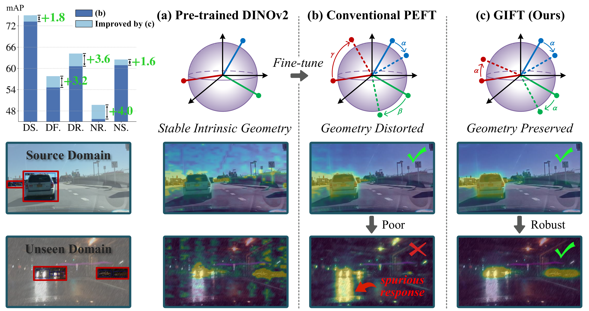

<p align="center">
  
</p>

<h2 align="center">
  🎁 GIFT: Representation Geometry Matters for Single-Domain Generalized Object Detection
</h2>

<p align="center">
  <a href="https://zhangyin1996.github.io/">Yin Zhang</a>,
  <a href="https://yaoyz96.github.io/">Yaoyue Zheng</a>,
  <a href="https://scholar.google.com/citations?user=mgpE1noAAAAJ&hl">Yongqiang Zhang</a>,
  <a href="https://scholar.google.com/citations?user=zdIW07oAAAAJ">Bogdan Raducanu</a>,
  <a href="https://openreview.net/profile?id=~Dan_Liu14">Dan Liu</a>
</p>

<p align="center">
  <strong>🎉 Accepted at NeurIPS 2026</strong>
</p>

## :bell: Updates
+ 2026-10-27: Paper is available. [arXiv](https://arxiv.org/pdf/2610.35374)
+ 2026-10-26: Code is available now.

<p align="center">
  
</p>

## 1. Pretraining Weights

* You can directly download the preprocessed weights from this [link](https://drive.google.com/drive/folders/1SGlq6eXOg2PWBB_aUdLFk5VuEQTxlCvs) and place them in the `checkpoints` folder.
* You can also follow the steps below to process them yourself.
  - Download pre-trained weights [dinov2_vitl14_pretrain.pth](https://dl.fbaipublicfiles.com/dinov2/dinov2_vitl14/dinov2_vitl14_pretrain.pth) from facebookresearch
  - Convert
  ```bash
  python tools/convert_models/convert_dinov2.py checkpoints/dinov2_vitl14_pretrain.pth checkpoints/dinov2_converted_1024.pth --height 1024 --width 1024
  python tools/convert_models/convert_dinov2.py checkpoints/dinov2_vitl14_pretrain.pth checkpoints/dinov2_converted_640.pth --height 640 --width 640
  ```

## 2. Environment Setup
```bash
# python 3.9, cuda 11.8, pytorch 2.2.0
conda create -n gift -y python=3.9
conda activate gift
conda install pytorch==2.2.0 torchvision==0.17.0 torchaudio==2.2.0 pytorch-cuda=11.8 -c pytorch -c nvidia
pip install -r ./requirements.txt
pip install albumentations==1.4.4 timm einops
pip install -U openmim
mim install mmengine
mim install mmcv==2.2.0
pip install xformers==0.0.24 --index-url https://download.pytorch.org/whl/cu118
pip install -v -e .
pip install numpy==1.26.0
```

## 3. Dataset Preparation
+ Download the [DWD](https://github.com/AmingWu/Single-DGOD), `/data/datasets/Single-DGOD`.
+ Download the [original Cityscapes](https://www.cityscapes-dataset.com/downloads/), `/data/datasets/cityscapes`, and prepare the  COCO-format detection annotations.
  - Run the following command:
  ```
  python tools/dataset_converters/cityscapes.py /data/datasets/cityscapes –nproc 8
  ```
  - Place the resulting `instancesonly_filtered_gtFine_train.json` and `instancesonly_filtered_gtFine_val.json` in the `/data/datasets/cityscapes/annotations/`.
+ The final dataset directory structure under `/data/datasets` is as follows:

```
|-- Single-DGOD/
|   |-- Daytime_Sunny/
|   |   |-- daytime_clear/
|   |       |-- VOC2007
|   |           |-- Annotations
|   |               |-- 0a0a0b1a-7c39d841.xml
|   |               |-- ...xml
|   |           |-- ImageSets
|   |               |-- Main
|   |                   |-- train.txt
|   |                   |-- ...txt
|   |           |-- JPEGImages
|   |               |-- 0a0a0b1a-7c39d841.jpg
|   |-- DaytimeFoggy/
|   |   |-- daytime_foggy/
|   |       |-- VOC2007
|   |           |-- ...
|   |-- Dusk-rainy/
|   |   |-- dusk_rainy/
|   |       |-- VOC2007
|   |           |-- ...
|   |-- Night_rainy/
|   |   |-- night_rainy/
|   |       |-- VOC2007
|   |           |-- ...
|   |-- Night-Sunny/
|   |   |-- Night-Sunny/
|   |       |-- VOC2007  ### [Important] The official 'Night-Sunny' dataset does not include a VOC2007 folder, you need to create one yourself.
|   |           |-- ...

|-- cityscapes/
|   |-- leftImg8bit/
|   |   |-- train/
|   |       |-- aachen/
|   |       |-- ...
|   |   |-- val/
|   |       |-- franfurt/
|   |       |-- ...
|   |-- annotations/
|   |   |-- instancesonly_filtered_gtFine_train.json
|   |   |-- instancesonly_filtered_gtFine_val.json
```
:rotating_light: During robustness evaluation, Cityscapes-C corruptions are generated on the fly, no pre-generated Cityscapes-C dataset is required.

## 4. Train and Test
+ DWD
```shell
# Train with Faster R-CNN (single GPU)
CUDA_VISIBLE_DEVICES=0 bash tools/dist_train.sh configs/gift/gift-faster-rcnn_r50_fpn_dwd.py 1 --amp --work-dir ./work_dir/gift_faster_dwd --find_unused_parameters
# Train with Faster R-CNN (mutiple GPUs)
CUDA_VISIBLE_DEVICES=0,1,2,3 bash tools/dist_train.sh configs/gift/gift-faster-rcnn_r50_fpn_dwd.py 4 --amp --work-dir ./work_dir/gift_faster_dwd --find_unused_parameters
# Test
bash tools/dist_test.sh configs/gift/gift-faster-rcnn_r50_fpn_dwd.py ./work_dir/gift_faster_dwd/epoch_12.pth 1 --work-dir ./work_dir/test_gift_faster_dwd

# Train with DETR-based detector Dino (single GPUs)
CUDA_VISIBLE_DEVICES=0 bash tools/dist_train.sh configs/gift/gift_dinov2_dinohead_bs1x4_dwd.py 1 --amp --work-dir ./work_dir/gift_detr_dwd --find_unused_parameters
# Train with DETR-based detector Dino (mutiple GPUs)
CUDA_VISIBLE_DEVICES=0,1,2,3 bash tools/dist_train.sh configs/gift/gift_dinov2_dinohead_bs1x4_dwd.py 4 --amp --work-dir ./work_dir/gift_detr_dwd --find_unused_parameters
# Test
bash tools/dist_test.sh configs/gift/gift-faster-rcnn_r50_fpn_dwd.py ./work_dir/gift_detr_dwd/epoch_12.pth 1 --work-dir ./work_dir/test_gift_detr_dwd
```

+ Cityscapes

```shell
# Taking a single GPU as an example, the same applies to multiple GPUs.
# Train on Source Domain (Cityscapes)
bash tools/dist_train.sh configs/gift/gift-faster-rcnn_r50_fpn_cityscapes.py 1 --amp --work-dir ./work_dir/gift_faster_cityscapes --find_unused_parameters

# test on Target Domain
bash tools/dist_test_robustness.sh configs/gift/gift-faster-rcnn_r50_fpn_cityscapes.py ./work_dir/gift_faster_cityscapes/epoch_12.pth 1 --out path/to/your/xxx.pkl --work-dir ./work_dir --corruptions benchmark
```
## 5. Results 
| Model  | Day Clear | Day Foggy | Dusk Rainy | Night Rainy | Night Clear | Avg. |mPC 
|:------:|:---------:|:---------:|:----------:|:-----------:|:-----------:|:----:|:----:|
| GIFT | 75.8      | 56.5      | 64.6      | 48.1        | 62.6        | 61.6| 58.0|

💻 We re-ran the experiments on October 23 using a single NVIDIA RTX 3090 GPU. You can follow the steps below to reproduce the results: 
+ Download the weight from here. [gift_faster_dwd](https://drive.google.com/drive/folders/1wRsuyERJVGrfR_DgNy3IRTpp7lQjOoFF).
+ Place it under `weights/` (create the folder if it doesn’t exist), e.g., `weights/gift_faster_dwd.pth`
+ Run evaluation:
```bash
python tools/test.py configs/gift/gift-faster-rcnn_r50_fpn_dwd.py weights/gift_faster_dwd.pth
```

## 6. Acknowledgment
+ The code is based on [Cauvis](https://github.com/lichen1015/Cauvis) (NeurIPS 2025) 
+ In addition, some ideas inspired by [OFT](https://oft.wyliu.com/) (NeurIPS 2023) and [PAID](https://github.com/wangkunyu241/PAID) (NeurIPS 2025).

**Many thanks for these great works!**
